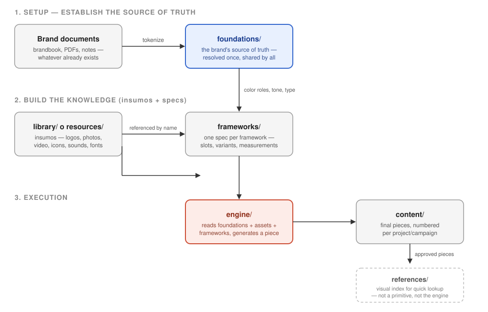

# Decodex

**Decodex es la codificación de una marca en código.** Es una metodología para
generar piezas de publicidad a escala, de forma **agéntica**: se toma el design system de una marca
(paleta, tipografía, logo, tono, plantillas) y se convierte en prompts y tokens estandarizados, para
que una IA pueda generar las piezas gráficas (HTML → PNG/JPEG) sin diagramar cada una a mano.

> Este repo es la **estructura estándar** que cualquier proyecto de marca en Decodex debe adoptar.

## La idea central

El diseño de una marca se documenta una sola vez, en un formato que tanto un humano como una IA
pueden leer sin ambigüedad. A partir de esa especificación, un motor genera cualquier cantidad de
piezas — distintos tamaños, canales, variantes de copy — sin que nadie tenga que diagramarlas una
por una a mano.

## Cómo funciona, en 3 niveles

1. **Foundations** — lo que nunca cambia de una pieza a otra: paleta, tipografía, logo, tono, límites
   legales. Se resuelve una sola vez, al principio de cada marca.
2. **Frameworks** — cada estructura visual reutilizable (ej. "producto + logo + texto abajo") se
   documenta en detalle: qué elementos tiene, cómo se comporta el texto largo, las medidas exactas de
   cada tamaño que cubre. Un framework, un documento.
3. **Engine** — el motor que lee esos documentos y genera las piezas reales. Se construye después de
   que foundations y frameworks ya están documentados, nunca antes.

## El flujo completo



## Qué hay en este proyecto

| Carpeta        | Qué guarda                                                                     |
| -------------- | ------------------------------------------------------------------------------ |
| `foundations/` | Base local heredada (paleta, tipografía, logo, tono, legal): se sincroniza una vez a Decodex y queda bloqueada |
| `frameworks/`  | Documentos de framework heredados: se sincronizan una vez a Decodex y quedan bloqueados |
| `library/`     | Los insumos crudos de la marca: logos, fotos, videos, íconos, sonidos, fuentes |
| `content/`     | Las piezas ya generadas, organizadas por proyecto/campaña                      |
| `references/`  | Miniaturas/montajes de frameworks ya aprobados, para consulta visual rápida    |
| `engine/`      | El motor que genera las piezas                                                 |

## Cómo se opera esto

Este proyecto está pensado para trabajarse junto a un agente de IA que sigue las instrucciones de
`CLAUDE.md` y las reglas de `RULES.md`. Un humano aporta el criterio de marca (brandbook,
aprobaciones, copy); la IA tokeniza, documenta cada framework, y genera las piezas — siempre
preguntando antes de inventar un valor, y pidiendo aprobación antes de escalar a más variantes o
tamaños. El detalle completo de cómo opera la IA vive en `.claude/knowledge/`.

Decodex es la fuente de verdad de la marca. Si un proyecto todavía tiene contenido en
`foundations/` o `frameworks/`, la skill `decodex-sync` lo pasa a Decodex una sola vez y luego
bloquea ambas carpetas con `.decodex-sync.json` (ver `RULES.md`). Solo el usuario puede
desbloquearlas, borrando ese archivo.

## Instalación

El arnés se instala siempre desde una **release** publicada en GitHub, nunca desde `main`. Hay dos
rutas:

- **Con el plugin de Claude Code** (`/decodex:new`): crea el proyecto de marca a partir de la última
  release. Ver el README del plugin.
- **Sin plugin**, con `install-harness.sh` (el repo es público, no requiere autenticación):

```bash
# Proyecto nuevo (la carpeta debe estar vacía o no existir)
curl -fsSL https://github.com/JoseCortezz25/delivery-system-starter/releases/latest/download/install-harness.sh \
  | bash -s -- --mode install --dir ./mi-marca

# Actualizar el arnés de un proyecto existente (no toca los datos de la marca)
curl -fsSL https://github.com/JoseCortezz25/delivery-system-starter/releases/latest/download/install-harness.sh \
  | bash -s -- --mode update --dir .
```

Opciones: `--version <tag>` fija una release concreta (por defecto, la más reciente) y `--dry-run`
muestra qué cambiaría sin escribir nada.

La actualización conserva lo del usuario: la marca y el proyecto de `codex-lock.json` (solo cambia
`harness.version`), los servidores MCP extra de `.mcp.json`, las líneas propias de `.gitignore` y
`.claude/settings.local.json`. Los cambios sin guardar en `content/`, `library/` y demás carpetas de
marca no la bloquean; solo se detiene si hay cambios sin guardar en archivos del arnés (que se
reemplazan), y `--force` la obliga a seguir. Usa `jq` o, si no está, `python3`; sin ninguno de los
dos no reescribe los JSON existentes.

No se corre desde una sesión de Claude abierta dentro del proyecto: los hooks del arnés bloquean y
revierten los cambios en `.claude/`, `CLAUDE.md` y `RULES.md`. Corre el comando en tu terminal, o usa
`/decodex:update` del plugin desde una sesión abierta en la carpeta padre del proyecto.

### Dependencias

| Dependencia | Para qué | Instalación (macOS) |
| --- | --- | --- |
| Claude Code | Operar el proyecto | — |
| `curl`, `tar` | Descargar e instalar el arnés | Vienen con el sistema |
| `jq` | **Obligatorio**: sin él, los hooks de protección bloquean todas las ediciones y comandos | `brew install jq` |
| Node.js (`npx`) | Servidores MCP de Playwright y Chrome DevTools | `brew install node` |
| Google Chrome | Abrir piezas y páginas de carga | — |
| Python 3.9+ con `.venv` | Exportar piezas a imagen | Ver abajo |
| Cuenta de Decodex | Conexión `decodex-brand` (login OAuth en el primer uso). Rol Codifier para configurar la marca, Maker para producir | Pedirla al equipo Decodex |

Entorno de Python, una vez por proyecto desde su raíz:

```bash
python3 -m venv .venv
.venv/bin/pip install playwright Pillow
.venv/bin/python -m playwright install chromium
```

## Conectar Decodex

La marca vive en Decodex, así que antes de trabajar hay que conectarse (el servidor `decodex-brand`
está declarado en `.mcp.json`; una conexión es una marca).

1. Abre la carpeta del proyecto en Claude Code (o Claude Desktop).
2. Aprueba los servidores MCP del proyecto cuando te lo pida (incluido `decodex-brand`).
3. Escribe `/mcp`, elige `decodex-brand` y la opción para autenticarte. Se abre el navegador para
   entrar con tu cuenta de Decodex (OAuth).
4. Vuelve al chat y verifica: pídele a Claude que te muestre la marca. Debe responder con el nombre
   de la marca (la herramienta `get_brand`) y, si el proyecto tiene `codex-lock.json`, coincidir con
   la marca del proyecto.

Tu cuenta necesita el rol **Codifier** (configurar la marca) o **Maker** (crear piezas); lo asigna
el equipo Decodex. Desde Claude solo se puede leer y guardar lo que ese rol permite.

### Si algo falla

| Síntoma | Qué hacer |
| --- | --- |
| No aparece `decodex-brand` en `/mcp` | No se aprobaron los servidores MCP del proyecto, o falta `.mcp.json` en la raíz. Reabre el proyecto y aprueba los servidores; si el archivo falta, actualiza el arnés (`--mode update`). |
| El inicio de sesión falla o entraste con otra cuenta | Repite el paso 3 desde `/mcp` y entra con la cuenta correcta. Si Claude dice que tu usuario no tiene acceso a la marca, pídele el acceso al administrador. |
| La sesión expiró o Claude dice que no has entrado | Escribe `/mcp`, elige `decodex-brand` y autentícate de nuevo; luego repite tu pedido. |
| Error de conexión a mitad de la sesión | Claude se detiene sin inventar valores ni guardar nada localmente y ofrece reintentar (volver a entrar con `/mcp`), consultar solo lo ya local o parar. |


### Crear o cambiar skills (mantenedores)

Las skills viven en este repo, en `.claude/skills/`, y llegan a los proyectos de marca solo con una
release (ver abajo; se actualizan con `--mode update`). Los diseñadores no pueden añadir las suyas
dentro de su proyecto, y es intencional, para proteger la integridad del arnés: los hooks bloquean
que la IA cree o edite archivos dentro de `.claude/` (`protect-claude-dir.sh`), bloquean los comandos
de shell que los cambien (`block-protected-delete.sh`) y revierten lo que se haya cambiado de todos
modos (`guard-verify.sh`). Si alguien de verdad necesita un cambio ahí, lo corre la persona misma
en su terminal con `!` (ver `RULES.md`); para algo permanente, se propone a los mantenedores.

### Publicar una versión (mantenedores)

El comando de una línea descarga el instalador desde la última release
(`releases/latest/download/install-harness.sh`), así que nunca hay que editar su versión. A cambio,
**cada release debe llevar `install-harness.sh` adjunto como archivo**.

1. Publica una pre-release, adjuntando el instalador. Los instaladores la ignoran por defecto:
   ```bash
   gh release create vX.Y.Z-rc.N install-harness.sh --target main --prerelease --title "vX.Y.Z-rc.N"
   ```
2. Pruébala desde cero (script y plugin). Como `latest` no apunta a una pre-release, usa la URL del tag:
   ```bash
   curl -fsSL https://raw.githubusercontent.com/JoseCortezz25/delivery-system-starter/vX.Y.Z-rc.N/install-harness.sh \
     | bash -s -- --mode install --dir ./prueba --version vX.Y.Z-rc.N
   ```
3. Publica la release final marcada como *Latest*, también con el instalador adjunto:
   ```bash
   gh release create vX.Y.Z install-harness.sh --target main --latest --title "vX.Y.Z"
   ```
