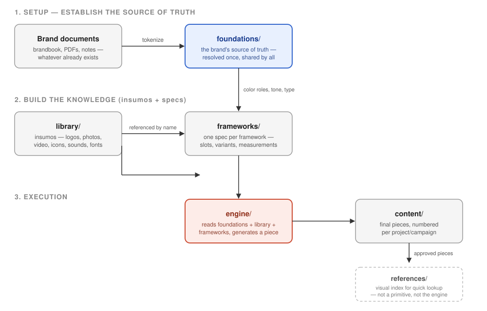

# Decodex

**Decodex es la codificación de una marca en código.** Es una metodología para
generar piezas de publicidad a escala, de forma **agéntica**: se toma el design system de una marca
(paleta, tipografía, logo, tono, plantillas) y se convierte en prompts y tokens estandarizados, para
que una IA pueda generar las piezas gráficas (HTML → PNG/JPEG) sin diagramar cada una a mano.

> Este repo es la **estructura estándar** (propuesta) que cualquier proyecto de marca en Decodex debería
> adoptar — todavía en construcción y sujeta a ajustes.

## La idea central

El diseño de una marca se documenta una sola vez, en un formato que tanto un humano como una IA
pueden leer sin ambigüedad. A partir de esa especificación, un motor genera cualquier cantidad de
piezas — distintos tamaños, canales, variantes de copy — sin que nadie tenga que diagramarlas una
por una a mano.

## Cómo funciona, en 3 niveles

1. **Foundations** — lo que nunca cambia de una pieza a otra: paleta, tipografía, logo, tono, límites
   legales. Se resuelve una sola vez, al principio de cada marca.
2. **Frameworks** — cada estructura visual reutilizable (ej. "producto + logo + texto abajo") se
   documenta en detalle: qué elementos tiene, cómo se comporta el texto largo, las medidas exactas de
   cada tamaño que cubre. Un framework, un documento.
3. **Engine** — el motor que lee esos documentos y genera las piezas reales. Se construye después de
   que foundations y frameworks ya están documentados, nunca antes.

## El flujo completo

## Qué hay en este proyecto

| Carpeta        | Qué guarda                                                                     |
| -------------- | ------------------------------------------------------------------------------ |
| `foundations/` | Base local heredada (paleta, tipografía, logo, tono, legal): se sincroniza una vez a Decodex y queda bloqueada |
| `frameworks/`  | Documentos de framework heredados: se sincronizan una vez a Decodex y quedan bloqueados |
| `drafts/`      | Borradores de framework mientras se construyen; la versión aprobada vive en Decodex |
| `library/`     | Los insumos crudos de la marca: logos, fotos, videos, íconos, sonidos, fuentes |
| `content/`     | Las piezas ya generadas, organizadas por proyecto/campaña                      |
| `references/`  | Miniaturas/montajes de frameworks ya aprobados, para consulta visual rápida    |
| `engine/`      | El motor que genera las piezas                                                 |

## Cómo se opera esto

Este proyecto está pensado para trabajarse junto a un agente de IA que sigue las instrucciones de
`CLAUDE.md` y las reglas de `RULES.md`. Un humano aporta el criterio de marca (brandbook,
aprobaciones, copy); la IA tokeniza, documenta cada framework, y genera las piezas — siempre
preguntando antes de inventar un valor, y pidiendo aprobación antes de escalar a más variantes o
tamaños. El detalle completo de cómo opera la IA vive en `.claude/knowledge/`.

Decodex es la fuente de verdad de la marca. Si un proyecto todavía tiene contenido en
`foundations/` o `frameworks/`, la skill `decodex-sync` lo pasa a Decodex una sola vez y luego
bloquea ambas carpetas con `.decodex-sync.json` (ver `RULES.md`). Solo el usuario puede
desbloquearlas, borrando ese archivo.
